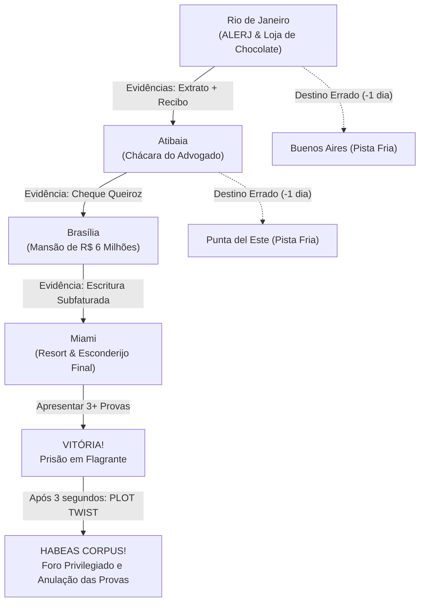

# 📋 Plano de Implementação: Jogo "Onde Está Flávio Bolsonaro?"
*Inspirado no clássico Where in the World is Carmen Sandiego? (VGA/DOS dos anos 90)*

---

## 🎯 1. Visão Geral do Projeto

O objetivo é desenvolver um jogo de investigação e sátira política point-and-click em formato web (HTML5/Canvas/JavaScript), com estética fiel de 16-bits da era DOS/VGA, baseado exatamente no design da imagem de referência fornecida e nas especificações do [`projeto_onde_esta_flavio.md`](file:///d:/projects/cadilhe/onde_esta_flavio/projeto_onde_esta_flavio.md) e [`roteiro-de-jogo.md`](file:///d:/projects/cadilhe/onde_esta_flavio/roteiro-de-jogo.md).

O jogador assume o papel de um **Agente Especial da Polícia Federal/Interpol** encarregado de rastrear o parlamentar foragido **"Flávio B."**, cruzando pistas financeiras (rachadinha, depósitos em dinheiro vivo da loja de chocolates, cheques do intermediário Queiroz e a mansão no Lago Sul) antes que os crimes prescrevam.

---

## 🖼️ 2. Especificação Visual e Anatômica da Interface

A interface do jogo reproduzirá com exatidão a disposição, cores e relevos da imagem de referência (proporção 4:3 clássica 800x600 / 640x480):

```
+-------------------------------------------------------------------------+
|                  ONDE ESTÁ FLÁVIO BOLSONARO?                            | <- Título Chanfrado 3D
+-------------------------------------------------------------------------+
|  +--------------------+  +-------------------------------------------+  |
|  |                    |  | [=] DOSSIÊ DE INVESTIGAÇÃO            [X] |  | <- Janela Estilo OS Retrô
|  |   [ RETRATO EM     |  |-------------------------------------------|  |
|  |     PIXEL ART ]    |  | Último paradeiro conhecido:               |  | <- Texto Teletype (Pixel)
|  |   (Flávio c/ chapéu|  | Cruzou a fronteira...                    |  |
|  |    fedora / NPCs)  |  | Movimentações atípicas em dinheiro vivo... |  | <- Barra de rolagem retrô
|  |                    |  |                                         |#|  |
|  +--------------------+  |                                         | |  |
|  | SUSPEITO: FLÁVIO B.|  |                                         |#|  |
|  +--------------------+  +-------------------------------------------+  |
+-------------------------------------------------------------------------+
|  +--------------------+  +---------------+  +---------------+           |
|  |   [ MINI-MAPA ]    |  |  INVESTIGAR   |  |   VER MAPA    |           |
|  | Continentes verdes |  +---------------+  +---------------+           |
|  | Rotas em vermelho  |  | INTERPOL / PF |  | CIA. AÉREAS   |  [VIAJAR] | <- Botões Beveled 3D
|  | Radar piscante     |  +---------------+  +---------------+           |
|  +--------------------+  DIAS RESTANTES ANTES DA PRESCRIÇÃO: 8          |
+-------------------------------------------------------------------------+
```

### Componentes de UI:
1. **Moldura Superior (Header):**
   - Título estilizado em relevo (*beveled 3D*) com tipografia pixel art prateada/branca e contorno escuro.
   - Efeito opcional de scanlines CRT (com botão retrô para ligar/desligar).
2. **Painel do Retrato (Esquerda):**
   - Borda chanfrada tripla (estilo DOS/Windows 3.1).
   - Retrato pixel art 16-bits do suspeito (Flávio de sobretudo e chapéu fedora) ou da testemunha/parceiro da fase atual (Queiroz, Corretor, Assessor).
   - Plaqueta rebaixada inferior dinâmica: `SUSPEITO: FLÁVIO B.`, `PARCEIRO: F. QUEIROZ`, `TESTEMUNHA: EX-ASSESSOR`, `CORRETOR DE IMÓVEIS`.
3. **Janela de Dossiê / Diálogo (Direita):**
   - Barra de título azul clássica (`#000088`) com botão `[X]`.
   - Barra de rolagem clássica cinza com setas funcionais e cursor de arraste.
   - Fundo escuro fosco (`#1e222a`) com texto verde ou branco em fonte pixelada, renderizado com efeito sonoro de máquina de escrever (*teletype*).
4. **Painel Inferior de Operações:**
   - **Mini-Mapa Mundi:** Canvas pixelado com continentes em verde vibrante, oceanos em azul marinho profundo, rotas pontilhadas em vermelho e indicador pulsante do paradeiro do jogador.
   - **Botoeira de Ação 3D (Beveled Buttons):**
     - `[INVESTIGAR]`: Interroga pessoas ou examina locais da cidade atual (ex: ALERJ, Kopenhagen, Chácara).
     - `[VER MAPA]`: Abre o mapa tático global ampliado com rotas de voo e histórico de viagens.
     - `[INTERPOL / PF]`: Dossiê policial completo (mandados de busca, evidências coletadas, lista de suspeitos).
     - `[COMPANHIAS AÉREAS]`: Consulta voos suspeitos, despachos de malas e bilhetes comprados em dinheiro vivo.
     - `[VIAJAR]`: Tela de seleção de voo para outras cidades, com animação retro de decolagem.
   - **Contador de Prescrição:** Indicador em vermelho alertando os dias restantes antes do arquivamento do processo.

---

## 🗺️ 3. Roteiro de Investigação, Evidências e Fases

O fluxo narrativo seguirá a progressão documentada:



### Detalhamento das Cidades:

| Local | Testemunhas / Interrogatórios | Evidência Obtida | Próximo Destino Indicado |
| :--- | :--- | :--- | :--- |
| **1. Rio de Janeiro** | **Ex-assessor da ALERJ** & **Atendente da Kopenhagen** | 📄 *Extrato com Movimentações Atípicas*<br>🍫 *Recibo de Depósito de Chocolate* | Atibaia (SP) |
| **2. Atibaia** | **Fabrício Queiroz** (fundos da chácara) | 📑 *Cheque Assinado e Mensagens WhatsApp* | Brasília (DF) |
| **3. Brasília** | **Corretor no Cartório do Lago Sul** | 🏠 *Escritura de Mansão Subfaturada* | Miami (EUA) |
| **4. Miami** | **Flávio B. Disfarçado** (Resort de Luxo) | 🚨 *Flagrante de Fuga Internacional* | **Clímax / Julgamento** |
| *Pistas Frias* | Buenos Aires, Punta del Este, Zurique | *(Nenhuma evidência - consome 1 dia de viagem)* | Retornar à rota correta |

---

## ⚖️ 4. Mecânicas de Fim de Jogo (Vitória, Derrota e o Plot Twist)

1. **Derrota por Prescrição (Dias = 0):**
   - O contador de dias zera.
   - Tela com música fúnebre/cômica em 8-bits: *"O tempo expirou! Os crimes prescreveram por decurso de prazo. O investigado comemora com champagne a bordo de uma lancha em Angra!"*
   - Botão: `[TENTAR NOVAMENTE]`.

2. **Vitória Parcial (Prisão):**
   - Ao confrontar o suspeito em Miami e apresentar pelo menos 3 evidências cruciais coletadas no dossiê:
   - Sirene da PF toca, luzes azul e vermelha piscam: *"PARABÉNS, AGENTE! Você reuniu as provas e prendeu o parlamentar foragido!"*

3. **O Grande Plot Twist (3 segundos após a vitória):**
   - Som estrondoso de carimbo judicial (*THUMP!*).
   - Uma decisão judicial em papel timbrado desce sobre a tela com o carimbo vermelho **"ANULADO / HABEAS CORPUS CONCEDIDO"**:
   - > *"DECISÃO MONOCRÁTICA DO STF: Reconhecida a incompetência do juízo de primeira instância e declarada a ilicitude das provas obtidas pelo COAF. O réu mantém o foro privilegiado retroativo. INVESTIGAÇÃO TRANCADA E SUSPEITO LIBERADO!"*
   - Opções finais: `[RECORRER AO PLENÁRIO (Jogar Novamente)]` ou `[PEDIR APOSENTADORIA ESPECIAL]`.

---

## 🔊 5. Sistema de Áudio Retro (Web Audio API Synthesizer)

Para não depender de links externos de áudio que quebrem ou falhem no carregamento, implementaremos um **motor de áudio chiptune 100% nativo** via Web Audio API do navegador:
- **Teletype Click:** Cliques mecânicos de teclado a cada letra exibida no dossiê.
- **Button Beep:** Bipe clássico de clique de terminal VGA/DOS.
- **Clue Jingle:** Arpeggio de 3 notas agudas ao descobrir uma nova evidência.
- **Flight Swoosh:** Efeito de viagem aérea ao mudar de cidade.
- **Police Siren:** Sirene oscilante de 8-bits na hora do enquadro.
- **Gavel/Stamp Slam:** Impacto estrondoso de baixa frequência para o carimbo da anulação judicial.
- **Toggle Mute/Volume:** Controle de som acessível no canto da tela.

---

## 📦 6. Arquitetura de Código Proposta

Utilizaremos uma arquitetura web moderna, modular e de carregamento instantâneo:

```text
onde-esta-flavio/
├── index.html                   # Estrutura HTML da janela retro e canvas do jogo
├── css/
│   └── retro.css                # Estilização DOS/VGA, chanfros 3D, scanlines e fontes pixel
├── assets/
│   ├── images/
│   │   ├── flavio_suspeito.png  # Retrato original do suspeito extraído da referência
│   │   ├── queiroz_npc.png      # Retrato pixel art de Fabrício Queiroz
│   │   ├── corretor_npc.png     # Retrato pixel art do corretor de imóveis
│   │   ├── flavio_miami.png     # Retrato de Flávio disfarçado em Miami
│   │   └── map_world.png        # Mini-mapa pixelado mundial com rotas
│   └── icons/                   # Ícones das evidências (chocolate, extrato, cheque, mansão)
└── js/
    ├── gameData.js              # Cidades, diálogos, pistas, conexões aéreas e itens
    ├── audioSynth.js            # Sintetizador chiptune nativo (Web Audio API)
    ├── mapCanvas.js             # Renderizador interativo do mapa e animação de rotas
    ├── uiManager.js             # Controle das janelas (Investigação, Dossiê, Companhias Aéreas)
    └── game.js                  # Loop de gameplay, estados, validação de vitórias e plot twist
```

---

## 🚀 7. Fases de Execução Sugeridas

1. **Etapa 1: Preparação de Assets & Layout Base**
   - Extrair e recortar os assets principais da imagem original de referência (`media_1793145209452.jpg`).
   - Gerar os retratos complementares dos outros personagens no mesmo estilo pixel art.
   - Montar o layout HTML/CSS com os chanfros 3D, barra de rolagem retrô e proporções exatas da imagem.

2. **Etapa 2: Motor de Som & Mini-Mapa**
   - Implementar o sintetizador Web Audio com todos os bipes, sons de digitação e jingles.
   - Criar o mini-mapa com rotas ativas e radar pulsante.

3. **Etapa 3: Sistema de Investigação & Dossiê Policial**
   - Conectar as ações de `[INVESTIGAR]`, `[INTERPOL / PF]` e `[COMPANHIAS AÉREAS]`.
   - Adicionar o inventário de evidências com visualização de documentos.

4. **Etapa 4: Sistema de Viagens & Destinos Falsos**
   - Implementar a tela de `[VIAJAR]`, dedução de dias e mensagens de pista fria.

5. **Etapa 5: Clímax, Encerramento e o Plot Twist Judicial**
   - Confronto em Miami, tela de vitória da PF e animação de impacto do carimbo de anulação com Habeas Corpus.

6. **Etapa 6: Validação no Navegador & Polimento Final**
   - Testar o fluxo completo de início ao fim, jogabilidade responsiva e fidelidade visual.
